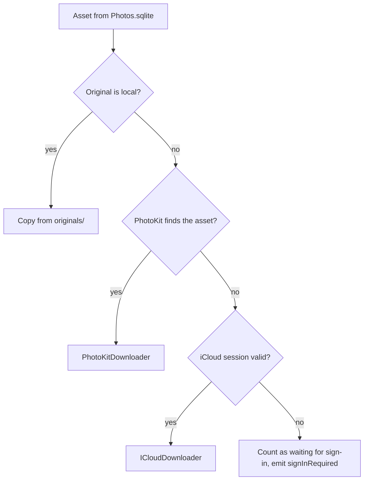
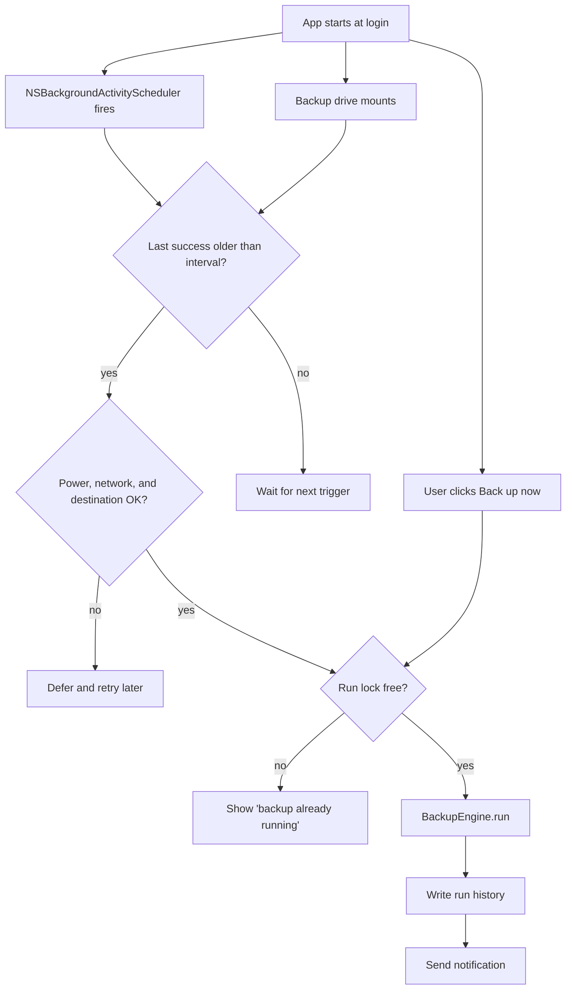
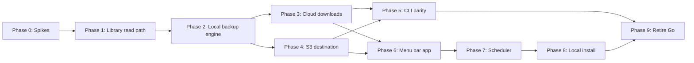

# Swift port plan

## Goal

Replace the Go command-line tool with a native Swift codebase. The result has two products:

- `Shoebox.app`: a menu bar app that runs backups on a schedule.
- `shoebox`: a command-line tool with the same commands as today.

The Swift port was named Darwin Photos until Phase 8. See "Rename to Shoebox".

Both products share one Swift library. The library contains all backup logic.

## Hard requirements

These requirements keep existing backups and settings valid. A violation forces a full re-upload of the library.

- The backup file name must stay `<UUID>.<ext>`. If the original file has no extension, the name must use `.jpg`.
- S3 uploads must use the same object key: `<prefix>/<UUID>.<ext>`.
- S3 uploads must send `If-None-Match: *`. A `412 PreconditionFailed` response must count as success.
- S3 objects must carry the same user metadata: `darwin-photos-uuid`, `date-created`, `date-modified` (RFC 3339, UTC), and `original-filename`.
- The Content-Type rules from `contentTypeForFilename` must stay the same.
- Local backups must set the file modification time the same way as `copyFile` in `cmd/backup.go`.
- The app must read `config.json` with the current schema. New keys can be added. Shoebox keeps it in `~/.shoebox`.
- The app must read and write `failures.db` with the current schema. Shoebox keeps it in `~/.shoebox`.
- The app must never write to `Photos.sqlite`. It must open a copy, as `openWithCopy` does today.

## Current code inventory

The Go code is about 6,800 lines. This table maps each Go package to its Swift replacement.

| Go code | Lines | What it does | Swift replacement |
|---|---|---|---|
| `internal/db` | ~970 | Reads `Photos.sqlite`: assets, albums, stats, cloud records | GRDB.swift, read-only, same SQL |
| `internal/models` | 85 | Asset and album types | Swift structs, `Sendable`, `Codable` |
| `internal/failures` | 200 | Failed-asset store | GRDB.swift, same schema |
| `internal/icloud` | ~840 | iCloud web API: setup discovery, CloudKit zones, download URLs, cookie session | `ICloudDownloader`, the fallback for assets that PhotoKit cannot see |
| `internal/browserauth` | 235 | Chrome login through chromedp to capture cookies | SwiftUI `WebView` login window, cookies from the `WebPage` data store |
| `internal/photokit` | 370 | cgo bridge to PhotoKit, used by `sync` | `PhotoKitDownloader`, the first choice for cloud-only assets |
| `internal/transfer` | 184 | Parallel cloud download workers | `TaskGroup` with a concurrency limit |
| `cmd/s3_*` | ~700 | S3 destination, scan, upload | AWS SDK for Swift (`AWSS3`) |
| `cmd/backup.go`, `export.go`, `sync.go` | ~1,200 | Command orchestration | `BackupEngine`, `ExportEngine`, `SyncEngine` in the library |
| `cmd/progress.go`, `transfer_progress.go` | ~435 | Terminal progress bars | `AsyncStream<BackupEvent>`; the CLI and the app each render it |
| `cmd/config.go` | 109 | Config file and flag precedence | `Settings` type, same JSON keys |
| Other `cmd/*.go` | ~700 | `stats`, `ls`, `cat`, `albums`, `failures` | swift-argument-parser subcommands |

## Technology choices

- **Language and platform.** Swift 6.2 with strict concurrency. Minimum macOS 26. This gives the native SwiftUI `WebView` and `WebPage` types for the iCloud login window, plus `MenuBarExtra`, `SettingsLink`, the Observation framework, and current PhotoKit APIs. The app is for one user, so an older target has no value.
- **Project layout.** One Swift package for the library and the CLI. One Xcode project for the app, which depends on the local package. Generate the Xcode project with XcodeGen so the project file stays out of merge conflicts.
- **SQLite.** GRDB.swift. It supports read-only connections, raw SQL, and good row decoding. The existing SQL in `internal/db/queries.go` ports with small changes.
- **S3.** The official AWS SDK for Swift. The `gstark` profile uses `credential_process` with a 1Password helper (`~/.aws/op-cred-helper`). The AWS SDK for Swift supports `credential_process` in its default chain. Soto does not, so Soto is not an option. The SDK also supports custom endpoints, path-style addressing, SSE-KMS, and conditional puts. It is large and slow to compile.
- **CLI parsing.** swift-argument-parser.
- **Logging.** `os.Logger` with the subsystem `com.gstark.darwin-photos`. Logs then appear in Console.app.

## Package structure

```
Package.swift
Sources/
  DarwinPhotosCore/
    Library/        PhotosLibrary (Photos.sqlite reader), Asset, Album, Stats
    Downloads/      CloudDownloader (routes each asset), PhotoKitDownloader, ICloudDownloader
    ICloud/         ICloudClient, SessionStore (Keychain), CloudKit zone lookup
    Destinations/   BackupDestination protocol, LocalDestination, S3Destination
    Engine/         BackupEngine, ExportEngine, SyncEngine, BackupEvent, RunLock
    Failures/       FailureStore
    Settings/       Settings, SettingsStore (config.json)
    History/        RunHistory (last runs, counts, errors)
  darwin-photos/    CLI entry point and subcommands
Tests/
  DarwinPhotosCoreTests/
App/
  project.yml       XcodeGen spec
  DarwinPhotos/     SwiftUI app sources
```

### Core interfaces

- `BackupDestination` is a protocol with three operations: list existing names, store a local file, and store a staged file. `LocalDestination` and `S3Destination` conform to it. This removes the separate local and S3 code paths that exist in `backup.go` and `s3_backup.go` today.
- `BackupEngine.run(options:) -> AsyncThrowingStream<BackupEvent, Error>` does one backup. Task cancellation stops the run.
- `BackupEvent` has these cases: `scanning`, `planned(local:cloud:bytes:)`, `progress(bytesDone:bytesTotal:rate:)`, `assetSucceeded`, `assetFailed(uuid:reason:)`, `authExpired`, `finished(Summary)`.
- `RunLock` takes an `flock` on `~/.darwin-photos/run.lock`. The app and the CLI must not run a backup at the same time.

## Asset list and downloads

The backup must include every asset that the Go tool backs up today. The Phase 0 spikes found these rules (see `phase0-results.md`):

- Only `Photos.sqlite` lists every asset. PhotoKit does not return hidden assets or photos saved from Messages (`ZSAVEDASSETTYPE = 12`), not even by local identifier. The asset list therefore comes from `Photos.sqlite`, and the app needs Full Disk Access.
- PhotoKit returns the same original bytes as the iCloud web API, and it needs no iCloud sign-in. It is about half as fast: 26 MB/s against 54 MB/s at concurrency 4.
- Only the iCloud web API can download cloud-only assets that PhotoKit cannot see.

### Download routing



- Most cloud-only assets go through PhotoKit. A scheduled run backs them up even when the iCloud session has expired.
- Only the assets that PhotoKit cannot see need the iCloud session. On the current library, these are 4 hidden assets.
- Neither path can download the 257 photos saved from Messages. The Go tool fails on them too. Phase 3 must check whether `~/Library/Messages/Attachments` has the originals.
- If PhotoKit fails for an asset that it can see, the engine tries `ICloudDownloader` before it records a failure.
- PhotoKit downloaded all 62 current assets that the Go tool records as failed. The order "PhotoKit first" therefore also backs up more assets than the Go tool.
- `FailureStore` must remove rows for assets that are no longer in the library. The current `failures.db` has 113 such rows.

### PhotoKitDownloader

1. Fetch the `PHAsset` with the local identifier `<UUID>/L0/001`.
2. Select the original resource: `.photo` for images, `.video` for videos.
3. Call `PHAssetResourceManager.writeData(for:toFile:options:)` with `isNetworkAccessAllowed = true` into a staging file.
4. Run downloads in a `TaskGroup` with the `workers` limit.

### ICloudDownloader

A port of `internal/icloud`: setup discovery, partition redirects, the China region, CloudKit zone lookup, download URLs, and retry rules. Spike 1 found these rules:

- The client must set the `Cookie` header itself. A session configured with an `HTTPCookieStorage` did not send the cookies.
- A 421 redirect loop means the session is not valid. The client must report it as `authExpired`, not as a network error.
- The client must send a Safari user agent.

### Other findings

### Video originals

The Go SQL treats the largest `ZINTERNALRESOURCE` row with `ZRESOURCETYPE = 0` as the original. For a video, type 0 rows are small still images. The video original is the largest type 1 row with a fingerprint. Example, a 203 MB video:

| `ZRESOURCETYPE` | Bytes | `ZLOCALAVAILABILITY` |
|---|---|---|
| 0 | 368,638 | -1 |
| 1 | 203,335,846 | 1 |
| 1 | 56,724,923 | -1 |

The Go tool therefore reports the wrong size for videos. It also reports a local video as "Cloud", so `backup` downloads it from iCloud instead of copying it. The port uses type 1 for videos (`ZKIND = 1`). Phase 1 made this change after the parity tests passed. From then on, `scripts/parity.sh` compares photos only, and `scripts/video-originals.sh` reports the video differences.

## iCloud login

The Go tool starts Chrome through chromedp, or imports a cookies file. The Swift app replaces both with a login window. Spike 1 proved this flow.

1. The app opens a window with a SwiftUI `WebView` that loads `https://www.icloud.com/photos/` through a `WebPage`.
2. The user signs in, including two-factor authentication.
3. The app detects the `X-APPLE-WEBAUTH-TOKEN` cookie and reads the cookies from the `WebPage` website data store.
4. The app stores the cookies in the Keychain, not in `session.json`. WebKit does not keep the sign-in after the app quits, so the Keychain copy is the only one that lasts.
5. The CLI reads the same Keychain item through a shared access group.
6. The CLI keeps `import-cookies` as a fallback.

On first launch, the app imports `~/.darwin-photos/session.json` if it exists, then stops using the file.

When the iCloud API rejects the session, the engine emits `authExpired`. The app shows a notification with a "Sign in" action that opens the login window. The menu shows how many assets wait for a sign-in.

## Menu bar app

### Structure

- `MenuBarExtra` with `.window` style, and a `Settings` scene for configuration. The `.menu` style shows only text items, so it cannot show a progress bar.
- `LSUIElement = YES`, so the app has no Dock icon.
- `AppModel` (`@Observable`, `@MainActor`) holds the current state: idle, running with progress, or failed. It also holds the last run and the next run time.
- The engine runs in-process. The app does not start a child process.

### Menu

```
✓ Last backup: today 03:12 (412 new)
  Next backup: tomorrow ~03:00
  37,314 items, 12 failed
─────────────
  Back up now          (Cancel during a run)
  Pause schedule
  Show failures…
  Open log
─────────────
  Settings…
  Quit
```

The menu bar icon changes for these states: idle, running, and needs attention.

### Scheduler



- `NSBackgroundActivityScheduler` fires every hour with a tolerance. The app then checks if a backup is due. With this design, a missed run after sleep runs soon after wake.
- The app watches `NSWorkspace.didMountNotification` for local destinations.
- During a run, `ProcessInfo.beginActivity(options: .idleSystemSleepDisabled)` keeps the Mac awake.
- `NWPathMonitor` reports expensive and constrained networks.
- `IOPSCopyPowerSourcesInfo` reports battery state.
- `SMAppService.mainApp` registers the app as a login item.
- `UNUserNotificationCenter` sends notifications.

### Settings

The settings window has these tabs.

| Tab | Settings |
|---|---|
| General | Start at login, notifications (all, failures only, off) |
| Destination | Local folder or S3. For S3: bucket and prefix, profile, region, endpoint, path style, SSE, KMS key ID, storage class |
| Schedule | Off, daily, or weekly. Preferred time window. Run when backup drive mounts. Only on power adapter. Skip on expensive networks |
| Advanced | Workers, retry failed assets on each run, iCloud account (signed-in state, sign in, sign out) |

The app writes these settings to `config.json`. The new keys are:

```json
{
  "schedule": {
    "frequency": "daily",
    "window_start": "01:00",
    "window_end": "06:00",
    "on_mount": true,
    "require_power": true,
    "skip_expensive_network": true
  },
  "retry_failed": false
}
```

The CLI ignores the `schedule` keys.

## AWS credentials for scheduled runs

The `gstark` profile gets credentials from 1Password through `credential_process`. This works for a run that you start yourself. A scheduled run at 03:00 has a problem: if 1Password is locked, the helper waits for Touch ID or fails, and the backup fails.

Options:

1. **Dedicated IAM user (recommended).** Create an IAM user that can only call `s3:ListBucket` on the bucket and `s3:PutObject` on the backup prefix. The app stores its access key in the Keychain. The settings window has fields for the key. A leaked key can only add objects, not read or delete them.
2. **1Password service account.** The helper uses a service account token that does not need an unlock. This keeps 1Password as the only store, but the token gives access to the whole vault that it can read.
3. **Keep the profile.** Scheduled runs then work only while 1Password is unlocked. The app must report a credentials failure as "needs attention", not as a generic error.

The CLI keeps using the AWS profile chain, so `--s3-profile gstark` still works by hand.

## Permissions and install

- **No App Sandbox.** The app reads `Photos.sqlite` directly and needs Full Disk Access. The Mac App Store is therefore not possible.
- **Signing.** Sign with an Apple Development certificate. A free Apple ID is enough. Do not use ad-hoc signing. macOS ties Full Disk Access to the code signature, and an ad-hoc signature changes on each build. You would then have to grant Full Disk Access again after every rebuild. Notarization is not necessary for an app that you build and run on your own Mac.
- **Info.plist.** Set `NSPhotoLibraryUsageDescription` for PhotoKit. The CLI also needs it. Embed it in the CLI binary with `-sectcreate __TEXT __info_plist`, as the PhotoKit spike does.
- **Onboarding.** The app needs two permissions: Full Disk Access and Photos access.
  - On first launch, the app tries to open `Photos.sqlite`. If that fails, the app shows a screen that explains the need and opens `x-apple.systempreferences:com.apple.preference.security?Privacy_AllFiles`. The app checks again when it becomes active.
  - The app then requests Photos access with `PHPhotoLibrary.requestAuthorization(for: .readWrite)`. If the user denies it, the app shows a screen that opens the Photos privacy settings.
- **CLI.** The app bundle contains the CLI at `Contents/MacOS/darwin-photos`. A `make install` task copies the app to `/Applications` and links the CLI into `~/.local/bin`.
- **Later, for a public release.** Developer ID signing, notarization, Sparkle updates, and a Homebrew cask. None of this is in scope now.

## Phases



### Phase 0: Spikes

Answer the risky questions before the main work starts.

1. Build a small app that signs in to iCloud in a SwiftUI `WebView`, reads the cookies, and calls the setup endpoint with them. This proves the login replacement.
2. Download ten cloud-only assets with `PHAssetResourceManager` and `isNetworkAccessAllowed`. Measure the speed. Check if the downloads fill the local Photos library cache. If PhotoKit is fast enough, it can replace the iCloud web API and remove the cookie login completely.
3. Upload a file with the AWS SDK for Swift and `If-None-Match: *`. Confirm the 412 handling. Test with the `gstark` profile (`credential_process`) and with static keys from the Keychain.
4. Confirm that an app signed with an Apple Development certificate keeps its Full Disk Access entry after a rebuild.

Exit criterion: each spike has a written result, and the open questions below have answers. The results are in `phase0-results.md`.

### Phase 1: Library read path

- Port `internal/db` and `internal/models` to `PhotosLibrary`.
- Port the CLI commands `stats`, `ls`, `cat`, and `albums`, with `--json`.
- Write parity tests. Run the Go and Swift `--json` commands against the same library, and compare the output.

### Phase 2: Local backup engine

- Port `FailureStore`, `Settings`, and `RunLock`. `RunHistory` moves to Phase 6, because only the app uses it.
- `LocalDestination` copies to a hidden temporary file, flushes it, and renames it. The Go tool copies straight to the backup name, so an interrupted copy leaves a partial file that later runs treat as backed up.
- Write `BackupEngine` with `LocalDestination` for local-only assets.
- Port `failures` and a local-only `backup` command.
- Add tests for file names, modification times, skip rules, and the failure store.

### Phase 3: Cloud downloads

- Write `PhotoKitDownloader` with a `TaskGroup` worker limit and the retry rules from `internal/transfer`.
- Port `internal/icloud` to `ICloudClient` and `ICloudDownloader`.
- Add the Keychain session store and the `session.json` import.
- Write `CloudDownloader`, which routes each asset as shown in "Download routing".
- Add cloud-only assets to `BackupEngine`.
- Port `export` and `sync`.
- Find where PhotoKit caches downloaded resources. Measure how much disk space a large backup uses.
- Test that the hidden assets and the Messages assets download through `ICloudDownloader`.

Phase 3 notes:

- `scripts/phase3-check.sh` runs the checks that need Full Disk Access: the session import, the hidden and Messages assets, the Messages attachments, the PhotoKit cache measurement, and a Go and Swift backup comparison.
- An asset that only the iCloud web API can get, while there is no valid session, is not recorded in `failures.db`. The next run after a sign-in tries it again. The run reports the count as "waiting for sign-in".
- The engine matches existing backup files on the UUID, not on the full name. The Go `export` named files with the extension from iCloud, which can differ in case from `ZFILENAME`.
- `export` uses the same routing as `backup`: local copy, then PhotoKit, then the iCloud web API. The Go `export` used only the iCloud web API.
- `export` is now a command group with the default subcommand `files`. A positional list otherwise takes the subcommand names. New subcommands: `import-session` (reads the Go `session.json`) and `status`. `export login` is not ported. The app login window replaces it in Phase 6.
- The CLI imports the Go `session.json` into the login Keychain on the first run that needs it. The Keychain item has no shared access group yet. Phase 6 adds one for the app. A rebuilt CLI binary has a new signature, so macOS can ask again for access to the item.
- The fingerprint fallback for records without a cloud master uses the original resource rule from "Video originals": type 1 for videos. Go used type 0.
- `scripts/messages-check.sh` looks for the files behind the Messages assets.

Messages assets:

The main library lists 257 assets saved from Messages (`ZSAVEDASSETTYPE = 12`). No download path works for them:

- The main library has no original files for them, and lists their size as 0.
- iCloud Photos has no record of them. The iCloud web API reports "no supported CloudKit download record".
- PhotoKit does not return them.
- All 257 are in the Shared with You library, `~/Library/Photos/Libraries/Syndication.photoslibrary`. That library has 14,629 assets, but its `originals` folder is empty. Almost all originals have `ZLOCALAVAILABILITY = -32768`.
- Only 11 match a file in `~/Library/Messages/Attachments` by name.

`backup` therefore leaves them out. To back up one of these photos, use Save to Library in Photos. The photo then becomes a normal iCloud Photos asset. Reading the Messages attachments through `chat.db` is an option for later.

### Phase 4: S3 destination

- Write `S3Destination` with key scan, conditional put, metadata, SSE, and storage class.
- Use multipart upload for large videos.
- Run the S3 tests against a local S3-compatible server, such as MinIO or RustFS.

Phase 4 notes:

- `S3Destination` is in its own module, `DarwinPhotosS3`. A clean build of the AWS SDK takes about 2.5 minutes.
- The naming, metadata, and Content-Type rules are in `S3Rules` in the core library. The Content-Type fallback copies Go's `mime.TypeByExtension`: the Go built-in table, then the system `mime.types` files.
- Files up to 16 MB use one PutObject. Larger files use a multipart upload with 8 MB parts. The complete request sends `If-None-Match: *`, so a multipart upload also never replaces an object. The Go uploader used 5 MB parts.
- The S3 client needs a region before it starts. The order is: `--s3-region`, `AWS_REGION` or `AWS_DEFAULT_REGION`, `s3.region` in `config.json`, and then the profile region in `~/.aws/config`.
- `scripts/s3-local-test.sh` starts a temporary MinIO server and runs the integration tests. `scripts/phase4-check.sh` compares the Go and Swift tools against the real bucket.
- Checked on 2026-10-14: both tools found the same 18 missing photos in the whole library. The Swift tool uploaded them, and the Go tool then found nothing missing.
- The Go tool had recorded 62 photos as cloud failures (iCloud NOT_FOUND). With `--retry-failed`, the Swift tool backed up all 62: 54 were local videos, and PhotoKit downloaded the other 8. The backup now has every photo in the library except the Messages assets.

### Phase 5: CLI parity

- Make every Go command and flag work in the Swift CLI.
- Known differences, accepted in Phase 1:
  - `ls --desc=false` becomes `ls --no-desc`.
  - `ls --offset` without `--limit` works. In Go, it is an SQL error.
  - The `cat` help no longer claims partial UUIDs and file names. Go does not support them either.
  - JSON output has the same values, but the formatting differs: `"key" : value` instead of `"key": value`.
  - `backup` reports "N already backed up" as the library assets that the destination has. Go reports the number of objects in the destination, which includes photos deleted from the library.
  - `stats` counts a video as downloaded only when the video file is local. Go checks the still image, so on 2026-10-14 Go reported 16 downloaded items (6.0 GB) and Swift reported 0.
- Run both tools with `backup --dry-run` against the same library and destination. The planned counts and bytes must match.

Phase 5 notes:

- Every Go command exists in the Swift CLI. The flags match, with the accepted differences above and these:
  - `--library` must come after the command name, as in `darwin-photos ls --library X`. swift-argument-parser has no global options.
  - `export login` and its flags `--timeout`, `--profile-dir`, and `--chrome-path` are gone. The app's login window replaces them, and the CLI reads the same Keychain session. `export import-cookies` stays as a fallback.
  - `version` prints only the version from the embedded Info.plist. Go also printed the commit and the build date.
- The dry runs differ by design: Swift leaves out the 257 Messages assets, and it counts videos by the video file. The missing counts must still match.

### Phase 6: Menu bar app

- Create the XcodeGen project, the `MenuBarExtra`, and `AppModel`.
- Add "Back up now", live progress, cancel, and the failures window.
- Add the Full Disk Access and Photos access onboarding screens.
- Add the iCloud login window.
- Add the settings window.

Phase 6 notes:

- The work is in four slices: (a) the project, the menu, Back up now, progress, cancel, and the failures window; (b) onboarding; (c) the iCloud login window; (d) the settings window.
- `App/build.sh` generates the Xcode project, builds it, signs the app with the Apple Development certificate, and copies it to `tmp/DarwinPhotos.app`. It passes `-skipPackagePluginValidation`, because the AWS SDK uses a build plugin that Xcode otherwise asks to trust.
- The app runs the same backup as `darwin-photos backup` without flags. It reads `config.json` and takes the run lock. `openDestination` and `S3Options(config:)` in `DarwinPhotosS3` are shared with the CLI.
- The app keeps the result of the last run in UserDefaults. Phase 7 replaces it with the run history.
- The `gstark` credential helper uses full paths for `op` and `jq`, so it works without the shell `PATH`.
- The app uses the hardened runtime, so its signature must include the `com.apple.security.personal-information.photos-library` entitlement. Without it, macOS denies Photos access with no prompt.
- Spike 4 passed: the app kept Full Disk Access after a rebuild signed with the same certificate.
- The settings window has the Destination and Backup tabs. The General and Schedule tabs come with Phase 7, and the iCloud account with the login window. `Settings.save` keeps the keys that it does not know, so a newer file keeps its `schedule` keys.
- The login window uses a web view that keeps nothing on disk. When the `X-APPLE-WEBAUTH-TOKEN` cookie appears, the app validates the cookies with Apple and saves the session in the Keychain. Settings has an iCloud tab with Sign In, Check Session, and Sign Out.
- The session is still a normal login Keychain item with no access group. A shared access group needs a provisioning profile. The app and the CLI each ask once for access. Phase 8 puts the CLI inside the app bundle with the same signature.
- Checked on 2026-10-14: the app backed up to the real bucket, the settings window tested the S3 connection, and the login window saved a working iCloud session. The session imported from the Go tool at 16:34 had expired by the evening (partition redirect loop). Check how long a session from the login window lasts.

### Phase 7: Scheduler

- Add `NSBackgroundActivityScheduler`, the drive-mount trigger, and the power and network checks.
- Add the login item, sleep prevention, and notifications.
- Test sleep and wake, unplugged power, a missing drive, a run while the network is offline, and an expired iCloud session.
- Add an option to run scheduled backups only on chosen Wi-Fi networks (`schedule.wifi_networks`). Back Up Now ignores it. A wired connection passes. Reading the network name needs Location Services permission.

Phase 7 notes:

- The work is in three slices: (a) the schedule rules, the run history, the hourly check, and the Schedule tab; (b) the conditions: power, expensive networks, Wi-Fi networks, the destination, and the drive-mount trigger; (c) the login item, sleep prevention, notifications, and the General tab.
- `ScheduleRules` decides when a backup is due. The window gives the earliest time of day. A daily backup is due when no backup succeeded since the start of the most recent window, so a Mac that sleeps through the window backs up soon after it wakes. The first backup waits for the window.
- `RunHistory` keeps the last 100 runs in `~/.darwin-photos/history.json`. The app and the CLI both write it, so a CLI backup also counts for the schedule. It replaces the last run in UserDefaults.
- The app checks for a due backup each hour with `NSBackgroundActivityScheduler`, 60 seconds after the Mac wakes, and 30 seconds after launch.
- `Schedule.waitReasons` decides if a due backup must wait: on battery (`require_power`, default on), on a hotspot or Low Data Mode network (`skip_expensive_network`, default on), on a Wi-Fi network that is not in `wifi_networks`, with no network for S3, or with the backup drive not connected for a folder. The menu shows the reasons.
- The app checks again when the network changes and when a volume mounts. Power changes wait for the hourly check.
- The Wi-Fi name comes from CoreWLAN. It needs Location Services permission, the `com.apple.security.personal-information.location` entitlement, and `NSLocationUsageDescription`. The app asks for it only when you click Add Current Network. Without it, a list of allowed networks makes every scheduled backup on Wi-Fi wait.
- During a run, `ProcessInfo.beginActivity` with `.idleSystemSleepDisabled` keeps the Mac awake. The display can still sleep.
- Notifications have three levels in the General tab: every backup, only problems (the default), or off. A sign-in reminder has a Sign In action and comes at most once a day. The menu bar label opens the login window for it, because the label view exists for the whole life of the app.
- Start at login uses `SMAppService.mainApp`. It registers the app at its current path, so turn it on again after Phase 8 moves the app to `/Applications`.
- The notification level is in UserDefaults, not in `config.json`, because only the app uses it.

### Phase 8: Local install

- Add a `make install` task that builds a Release app, signs it with the Apple Development certificate, copies it to `/Applications`, and links the CLI.
- Set up the dedicated IAM user, or choose another option from "AWS credentials for scheduled runs".

Phase 8 notes:

- `scripts/create-backup-iam-user.sh` creates the `darwin-photos-backup` IAM user with an inline policy: `s3:ListBucket` on the bucket, and `s3:PutObject` and `s3:AbortMultipartUpload` on the backup prefix. It saves a new access key in the login Keychain (service `com.gstark.darwin-photos`, account `aws-access-key`) and never prints the secret. Each run replaces the old keys.
- `s3:ListBucket` has no prefix condition, because `HeadBucket` needs it without a prefix. The user can list key names but cannot read objects.
- `s3:PutObject` can replace an object with the same key. The tools always send `If-None-Match: *`, but a leaked key could still replace objects. Bucket versioning keeps the old versions, and the script reports whether it is on.
- With a key in the Keychain, the app uses it for backups and for Test Connection. The Destination tab chooses between the AWS profile and the access key.
- `make install` runs `App/install.sh`. It builds the CLI and a Release app, copies the CLI to `Contents/MacOS/darwin-photos`, and signs the CLI (identifier `com.gstark.darwin-photos.cli`) and then the app with the Apple Development certificate and the app entitlements. It replaces `/Applications/DarwinPhotos.app` and links `~/.local/bin/darwin-photos`. `APPLICATIONS`, `BIN_DIR`, and `OPEN=0` change the targets for a test.
- Checked on 2026-10-14: the IAM user's key passed Test Connection, bucket versioning is on, and `make install` installed the app and the CLI. The installed app kept Full Disk Access and Photos access, and the login item registered without a prompt.

### Rename to Shoebox

On 2026-10-14, the Swift port got the name Shoebox. All names changed:

| Item | Old | New |
|---|---|---|
| App | `DarwinPhotos.app`, "Darwin Photos" | `Shoebox.app`, "Shoebox" |
| CLI | `darwin-photos` | `shoebox` |
| Bundle ID | `com.gstark.darwin-photos` | `com.gstark.shoebox` |
| CLI identifier | `com.gstark.darwin-photos.cli` | `com.gstark.shoebox.cli` |
| Keychain service | `com.gstark.darwin-photos` | `com.gstark.shoebox` |
| Data folder | `~/.darwin-photos` | `~/.shoebox` |
| Swift modules | `DarwinPhotosCore`, `DarwinPhotosS3` | `ShoeboxCore`, `ShoeboxS3` |

These names did not change:

- The S3 metadata key `darwin-photos-uuid`. The objects in the bucket already have it.
- The IAM user and policy `darwin-photos-backup`.
- The Go tool. It still uses `~/.darwin-photos`. `export import-session` still reads `~/.darwin-photos/session.json`.

The CLI moved from `Contents/MacOS` to `Contents/Helpers/shoebox`. The file system ignores case, so `Contents/MacOS/shoebox` replaced the app binary `Contents/MacOS/Shoebox`, and the app ran the CLI and quit.

`scripts/migrate-to-shoebox.sh` moves an existing install one time. It deletes the old app, copies the data files, the Keychain items, and the preferences, and removes the old permissions. The new bundle ID needs Full Disk Access, Photos, Location, and notification permissions again.

### Phase 9: Retire Go

- Run the Swift app as your only backup tool for two weeks.
- Then delete the Go code and update the README.
- Delete `scripts/migrate-to-shoebox.sh` and the comparison scripts.

## Test plan

- **Unit tests.** Use Swift Testing for file names, metadata, SQL row decoding, the failure store, settings precedence, and scheduler decisions. Inject a clock so scheduler tests do not depend on real time.
- **Fixture library.** Use a small copy of a `Photos.sqlite` file with known assets. Commit it only if it contains no personal data. Otherwise, keep it outside the repo and point to it with an environment variable.
- **Parity tests.** Compare the Go and Swift output during Phases 1 to 5.
- **S3 tests.** Run against a local S3-compatible server.
- **Manual tests.** Sleep and wake, Full Disk Access revoked, Photos access revoked, iCloud signed out, drive removed during a run, and network lost during a run.

## Open questions

| Question | Default if no answer |
|---|---|
| Where does PhotoKit cache downloads, and how large can the cache get? | Phase 3 measures it |
| Which AWS credentials do scheduled runs use? | Dedicated IAM user with keys in the Keychain |
| Must the CLI stay? | Yes, inside the app bundle |

## Decisions

| Decision | Answer |
|---|---|
| AWS profile type | `credential_process` with 1Password. Use the AWS SDK for Swift |
| Audience | Personal use only. No notarization, Sparkle, or Homebrew for now |
| Minimum macOS version | macOS 26 |
| Asset list | `Photos.sqlite` with Full Disk Access. PhotoKit does not return hidden assets or Messages assets |
| Shared album assets | Skip them, as the Go `backup` does (13,055 assets). A setting to include them is an option for later. PhotoKit returns all of them, so the download path already supports them |
| Messages assets | Skip them in `backup` (257 assets, `ZSAVEDASSETTYPE = 12`). The Go `backup` includes them and fails on each one. `export` with UUIDs still attempts them. See "Messages assets" in Phase 3 |
| Cloud-only downloads | PhotoKit first. The iCloud web API for assets that PhotoKit cannot see. The backup must get every asset it can |
| AWS credentials for scheduled runs | A dedicated IAM user (option 1). The app keeps its access key in the Keychain. The CLI keeps the AWS profile |

## Main risks

- **iCloud web API changes.** The API has no documentation. It can change without notice. Only the assets that PhotoKit cannot see depend on it.
- **PhotoKit cache growth.** PhotoKit keeps downloaded resources in a system cache. A full backup of the library can fill the disk if the system does not clear the cache.
- **Slower first backup.** PhotoKit is about half as fast as the iCloud web API.
- **Unseen WAL changes.** The library opens `Photos.sqlite` with `immutable=1`, as the Go tool does. SQLite then ignores the `-wal` file, so a backup does not see changes that Photos has not checkpointed yet. A scheduled run can therefore miss the newest photos until a later run. `scripts/phase3-check.sh` shows the WAL size.
- **Photos.sqlite schema changes.** A new macOS version can rename columns. The library must detect a failed query and report it clearly. It must not report zero assets.
- **AWS SDK for Swift build time.** It adds minutes to a clean build. Keep it in its own module so other modules do not rebuild with it.
- **Full Disk Access.** If the user does not grant it, the app cannot work. The onboarding screen must be clear.
- **Locked 1Password at night.** If scheduled runs use the `gstark` profile, they fail while 1Password is locked. See "AWS credentials for scheduled runs".
